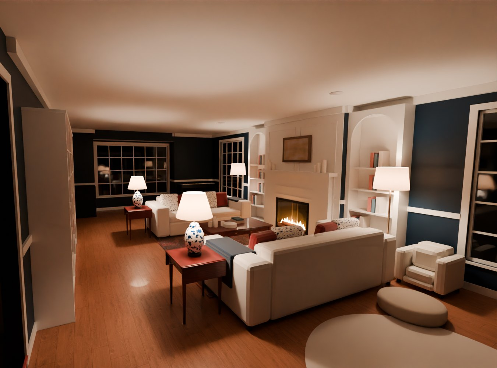
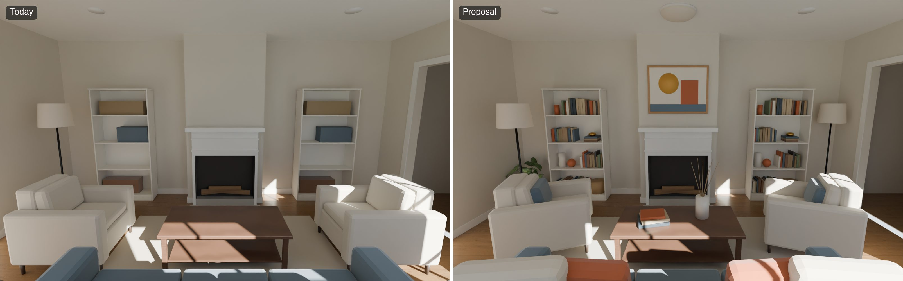
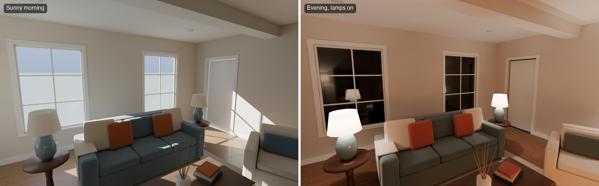
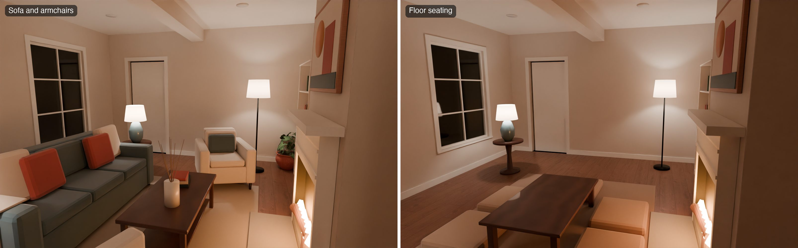
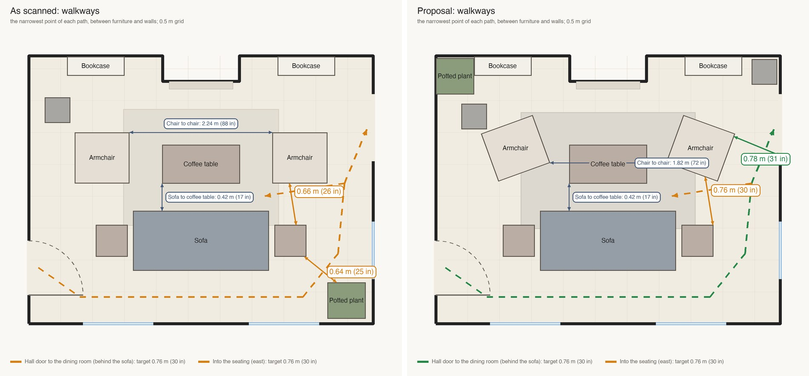
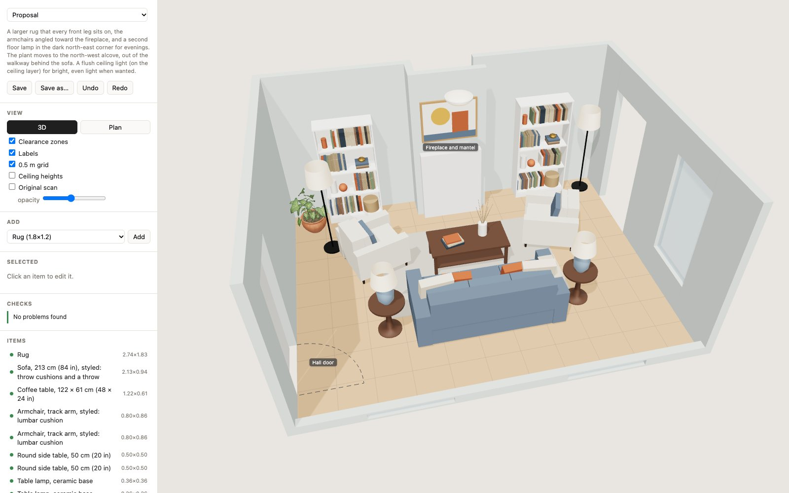
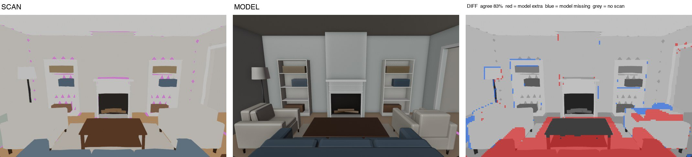

# Roomwright

Roomwright is a toolkit that gives AI agents an opinionated workflow for designing and laying out interior spaces: layout, furniture selection, lighting, and almost anything else an agent can do. The opinions are about process (measure first, check the model against the scan), not about taste.

A coding agent such as Claude Code or Codex runs it for you. You give it a 3D scan of a room and say what you want. It builds a model of the room, checks it against the scan, tries layouts and writes a report: what it recommends, why, and what to buy or have made. It uses Blender to make realistic renders: accurate lighting, paint color, light locations and color temperatures, and daylight through the windows. That way both you and the agent can judge how the space looks and feels.

With an iPhone LiDAR scan, the model should be able to get within an inch or two (a few cm) of the real room, but before making any large decisions like furniture purchases or moving large pieces, please always double check with a tape measure.



<sub>A real room, rendered by Roomwright from its LiDAR scan. The room is measured to within an inch or two, every piece is modeled at its real size, and the lamps are lit from their bulbs' real brightness and color temperature. Roomwright helped lay out the space and recommended lamps and furniture to meet the preferences of the homeowner.</sub>

## How it works

<picture>
  <source media="(prefers-color-scheme: dark)" srcset=".github/media/how-it-works-dark.png">
  
</picture>

## Get started

1. **Scan the room** with an iPhone Pro or iPad Pro (they have a LiDAR sensor) and a free scanning app like [Scaniverse](https://scaniverse.com). Walk slowly and get the ceiling and every corner. Most Android phones don't have LiDAR; scanning apps there build the model from photos, which works but is less precise.
2. **Export the scan as a GLB file** and copy it to your computer.
3. **Hand it to a coding agent.** Open Claude Code, Codex, or another coding agent that can run commands on your computer and has vision (it needs to look at its own renders). Point it to this repo and the GLB file. You can also give it some basic guidance, like:
    - "Make the living room feel less cramped."
    - "Find a better spot for the TV."
    - "We need more light in the evening, without adding ceiling lights."
    - "Add a reading corner by the window."
    - "My dad uses a walker. Make it easy to get around."
    - "We're selling. Stage this room cheaply for the listing photos."

The agent installs everything, asks a few questions about your home and the room, and comes back with renders and a report. Rendering runs on your own computer and costs nothing. The first render downloads Blender (about 400 MB).

## What you get

The pictures below are of a made-up sample room that comes with the repo, so you can try every tool before scanning your own.



Today and the proposal, from the same spot.



Daylight comes in through the room's real windows. In the evening the light comes only from the lamps and the fire; nothing is added to brighten the picture.



You can do pretty much anything the agent is capable of, and Roomwright is designed to introduce no biased taste of its own.



Walkway widths, measured at the narrowest point of each path. Moving the plant and angling the chairs takes the way behind the sofa from 0.64 m (25 in) to 0.78 m (31 in).



A 3D editor in the browser for moving things around. It flags overlaps, door swings and tight clearances as you drag.



Before showing you a render, the agent checks its model against your scan. Here it catches a sofa placed 30 cm (1 ft) off. Red is where the model has something the scan doesn't.

## Try it without a scan

The sample room above comes with a stand-in scan, so every tool runs. You need [uv](https://docs.astral.sh/uv/).

```sh
uv tool install git+https://github.com/ravimody/roomwright
roomwright demo my-demo && cd my-demo/rooms/sample-living
roomwright geometry-check draft-with-mistakes
roomwright render-photoreal proposal --lighting evening --views fireplace --samples 16
```

## Setting up by hand

What the agent runs in step 3, if you'd rather do it yourself:

```sh
uv tool install git+https://github.com/ravimody/roomwright
roomwright doctor                                    # checks this computer
roomwright init my-home && cd my-home                # HOUSEHOLD.md (a short questionnaire) and AGENTS.md
roomwright new-room living-room ~/Downloads/living-room.glb
```

Then open `my-home` in your agent. The `AGENTS.md` that `init` writes points it at the docs: [QUICKSTART](docs/QUICKSTART.md) for the commands, [COOKBOOK](COOKBOOK.md) for how to do each step well, [DESIGN_GUIDE](docs/DESIGN_GUIDE.md) for clearances, light levels and sizes, and [ARCHITECTURE](ARCHITECTURE.md) for how it works.

## Good to know

- Tested on macOS (Apple silicon). Linux should work but hasn't been tested; Windows hasn't either.
- Needs uv and Node 18 or later; the agent can install both. Git is optional.
- Tested with Claude Code and Codex. Other agents, like Gemini CLI, Cursor, or your own setup, should work but haven't been tried. Details in [AGENT_SETUP](docs/AGENT_SETUP.md).
- Your rooms, photos and reports stay in your own folder. Cloud rendering on [Modal](https://modal.com) is optional, on your own account, at about $0.01 per picture.

## License

Apache-2.0. See [LICENSE](LICENSE) and [NOTICE](NOTICE).
